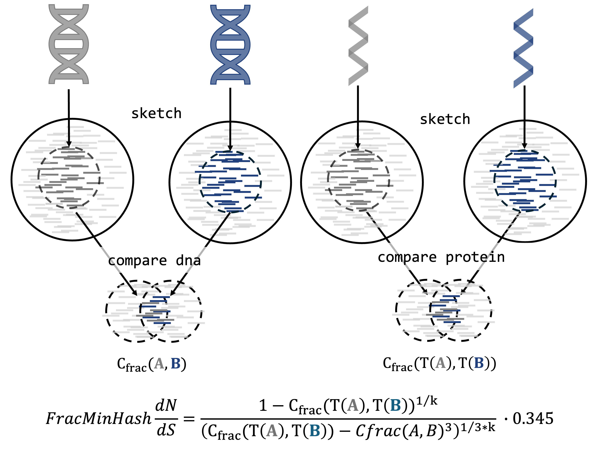

## FracOmega

FracMinHash d<sub>N</sub>/d<sub>S</sub>: an alignment-free measure of selection pressures for metagenomic samples 

Traditional d<sub>N</sub>/d<sub>S</sub> models infer selection pressues of protein-coding genes by estimating the rates of nonsynonymous substitutions to synonymous ones using sequence alignments. However, as sequencing becomes more accessible and data volumes grow, alignment-free methods are gaining traction. Therefore, we developed an alignment-free d<sub>N</sub>/d<sub>S</sub> estimator to apply on pairwise analyses of longer sequences such as genomes. 

The FracMinHash containment index has been linked to the simple mutation model, enabling alignment-free estimation of average nucleotide identity (ANI) and mutation rates between genomes. This framework has been extended to protein sequences via average amino acid identity (AAI), allowing joint estimation of d<sub>N</sub>/d<sub>S</sub> ratios for genomic selection pressures.

In short, by sketching genomes with FracMinHash and comparing containments, evolutionary metrics such as d<sub>N</sub>/d<sub>S</sub> can be inferred without sequence alignments. 


Manuscript under preparation. Recent available status can be found here:
>Rodriguez, J. S., Hera, M. R., & Koslicki, D. (2025). Leveraging FracMinHash containment for genomic dN/dS. bioRxiv. https://doi.org/10.1101/2025.11.12.688019

</br>

## Quick start

This is a quick demonstration for users to learn how to use FracMinHash d<sub>N</sub>/d<sub>S</sub> at a larger scale. Go to [Demo](https://github.com/KoslickiLab/dnds-using-fmh/tree/main/demo) to perform pairwuse estimations of FracMinHash d<sub>N</sub>/d<sub>S</sub> estimations of a small dataset. 


### Contents

- [FracOmega](#fracomega)
   * [Quick start](#quick-start)
   * [FracOmega setup](#fracomega-setup)
   * [Usage](#usage)
      + [FracOmega workflow](#fracminhash-d<sub>n</sub>/d<sub>s</sub>-workflow)
      + [FracOmega Commands Overview](#executing-fracminhash-d<sub>n</sub>/d<sub>s</sub>)


## Setup

### Clone GitHub Repo to your machine

FracOmega is yet to become a package that can be directly installed (sadly) but feel free to clone the git repository with the following command.

```
# Clone github repository
git clone https://github.com/KoslickiLab/dnds-using-fmh.git
cd dnds-using-fmh
```

### Environment setup

There are two ways to setup an environment to run FracOmega. You can either setup your environemtn the long way or the quick way. We first present the long way to setting up the enviroment.


Create and activate conda environment with core dependencies via `mamba`:
```
mamba create -y -n fmhdnds sourmash-minimal
mamba activate fmhdnds
```

Install the following dependencies using mamba and pip:
```
# mamba install
mamba install -c conda-forge sourmash_plugin_branchwater biopython loguru pandas numpy scipy matplotlib more-itertools

# pip install
pip install fuzzywuzzy python-dateutil
```

A quicker way to setup your environment is by using the environment.yml file and running the following commands:
```
# Create environment to use FracOmega
mamba env create -f environment.yml
mamba activate fmhdnds
```

### Notes
If `mamba` is not found after installing Miniforge, run:
```bash
  mamba shell init --shell bash --root-prefix=~/miniforge3
  source ~/.bashrc
```

## FracMinHash d<sub>N</sub>/d<sub>S</sub> Workflow

In the intitial steps of estimating FracMinHash d<sub>N</sub>/d<sub>S</sub>, sourmash is used to sketch genomic datasets and conduct pairwise comparisons, producing FracMinHash containment indices required for estimating FracMinHash d<sub>N</sub>/d<sub>S</sub>.

After generating these sketches, the pairwise containment indices for both DNA and protein sequences are calculated individually. 

Finally, these containment indices are utilized within Python scripts to estimate FracMinHash-based d<sub>N</sub>/d<sub>S</sub>.



## Executing FracMinHash d<sub>N</sub>/d<sub>S</sub> 

The script utilizes the following required parameters.

  | Parameter         | Explanation                                                  |
  | ----------------- | ------------------------------------------------------------ |
  | fasta_input_list  |  Input csv file that contains fasta files for sketching. This csv file follows sourmash scripts example, where in the first column is name, second column is dna fasta filename, and third column is protein fasta filename. |
  | scaled_input      | Identify a scaled factor for signature sketches. Default: 500. Use a scale factor of at least 10 for thousands of genomes. |
  | ksize             | Length of k-mer. This is the k-mer size for the amino acid (i.e., kaa). The program obtains the k-size of the nucleotide sequencing by calculating 3*kaa. Default is 7.|
  | directory         | Output directory for estimations. |
  | cores             | Total core usage (default: 100, ideal when using thousands of genomes)   |
  | threshold         | Set containment threshold (default: 0.05, used in sourmash plugin branchwater commands) |

To execute, use the following commad: 

```python3 fmh_dnds.py --fasta_input_list datasets.csv --directory . ```

## All pairs of many closely related genomes: `--mode reference`

`--mode main` compares every pair of sketches with `sourmash scripts pairwise`. For a large collection
of closely related genomes, such as tens of thousands of isolates of one species, almost every hash
is shared by almost every genome, and comparing complete sketches pair by pair repeats the same work
for every pair. `--mode reference` reports the same numbers by a faster route:

* the sketches are made exactly as in `main` (`sourmash scripts manysketch`, nucleotide k = 3 × ksize
  and protein k = ksize, from the same input csv), or read from existing sketch files (`--sketches`);
* each sketch is compared once with the sketch of one genome of your choice (`--reference`), keeping
  only the hashes it lacks and the hashes it adds relative to that genome;
* the intersection of every pair then follows exactly from
  `|S_i ∩ S_j| = |R| − |lacks_i| − |lacks_j| + |lacks_i ∩ lacks_j| + |adds_i ∩ adds_j|`,
  and the two `∩` counts of all pairs come from one sparse matrix product;
* max containment, PdN, PdS, PdN/PdS and dN/dS are then computed by the same functions in
  `src/dnds.py` as in `main`, with the same formula and the same constant (0.77/2.23).

The identity is exact for any genomes, so the containments and dN/dS values are identical to those
of `main` (`tests/check_reference_mode.py` checks this pair by pair). It is only *faster* when the
genomes are close to the reference; for diverged genomes use `main`.

  | Parameter (reference mode) | Explanation |
  | -------------------------- | ----------- |
  | reference     | Name (first column of the csv) of the genome to compare the others with. Any genome gives the same numbers; one close to all others is fastest. Required. |
  | sketches      | Existing sketch zip files to use instead of sketching `fasta_input_list`. |
  | scaled_input  | Scale factor of the comparison. With `--sketches`, set it to the scale factor the sketches were made with (or coarser). |
  | downsample_to | Comma-separated coarser scale factors at which to repeat the comparison from the same sketches, e.g. `2,5,10`. Downsampling keeps the hashes at or below sourmash's maximum hash for that scale factor, which is what sketching at that scale factor gives. |
  | names         | File with one genome name per line, to compare only those genomes (and the reference). |
  | sketch_shards | Sketch the input csv in this many parts side by side, one zip per part (default 1). The sketches are the same; for thousands of genomes at small scale factors, writing a single zip is otherwise the slowest step. |
  | write_csv     | Also write each result as one `fmh_omega_<ksize>.csv`, as `main` does (for up to a few million pairs). |
  | threshold     | As in `main`: a pair is reported for a molecule when its max containment exceeds the threshold; a pair reported for only one molecule has no value for the other and no dN/dS. |

Output: one folder per scale factor, `<directory>/reference_scaled<S>/`, holding the pairs as parquet
files in `pairs/` (read them all with `pandas.read_parquet("<folder>/pairs")`) with the columns of
`main`'s `fmh_omega_<ksize>.csv` (`query_name`, `match_name`, `DNA_max_Cfrac`, `AA_max_Cfrac`, `ksize`,
`PdN`, `PdS`, `PdN/PdS`, `dN/dS`), and a `run.json` with the number of sketches and pairs and the run
times. The numerator (`PdN`) and denominator (`PdS`) of the estimate are reported separately, as in
`main`, so either can be used on its own.

```
python3 fmh_dnds.py --mode reference --reference GENOME_NAME \
    --fasta_input_list datasets.csv --scaled_input 1 --downsample_to 2,5,10 \
    --sketch_shards 50 --directory out --cores 100 --threshold 0
```


<!--
FRACdNdS is a scalable dN/dS estimator for genomes that leverages the sketching approach FracMinHash.

FRACdNdS estimates dN/dS at a genomic level by deriving the containment indexes for between two genomes at a nucleotide and protein level. In practice, the dN/dS ratio infers selection pressues of protein-coding genes by estimating the rates of nonsynonymous substitutions to synonymous ones. We developed a dN/dS estimator to apply on pairwise analyses of longer sequences such as genomes. Currently, FRACdNdS is applied on a FASTA files and has two modes of execution: (1) "sngl" for using a single FASTA with multiple genome entries and (2) "bwpair" for using multiple individual FASTA files, where each FASTA file contains the gene sequences of one genome. 

For detailed usage and installation instructions please visit: coming soon.


Citing FRACdNdS

Please cite: coming soon.

# Requirements

FRACdNdS >= v is written in python3 and requires the following dependencies:

- X
- Y
- Z

# Installation

## Conda environment

under construction

```
# Create the conda ennvironment
conda create -n fracdnds

# Activate the conda environment
conda activate fracdnds

# Download and install dependencies
conda install -c bioconda -c conda-forge XYZ

# Clone the github directory
git clone XYZ
cd FRACdNdS
python setup.py install
```

# Quick start

demo coming soon

To run, simply invoke the `nohup bash run_fmh_omega.sh > log 2>&1 &` script. Other scripts are supporting scripts.

If you need memory information, invoke `nohup /usr/bin/time -v bash run_fmh_omega.sh > log 2>&1 &`

# Usage 

## Overview

## Workflow

>
